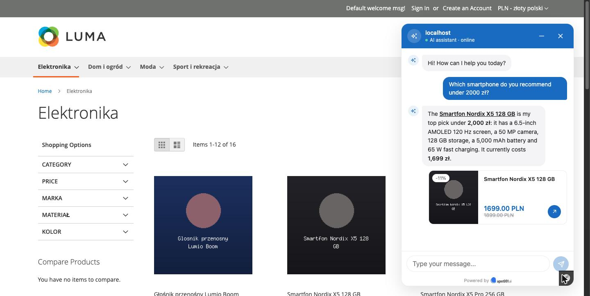
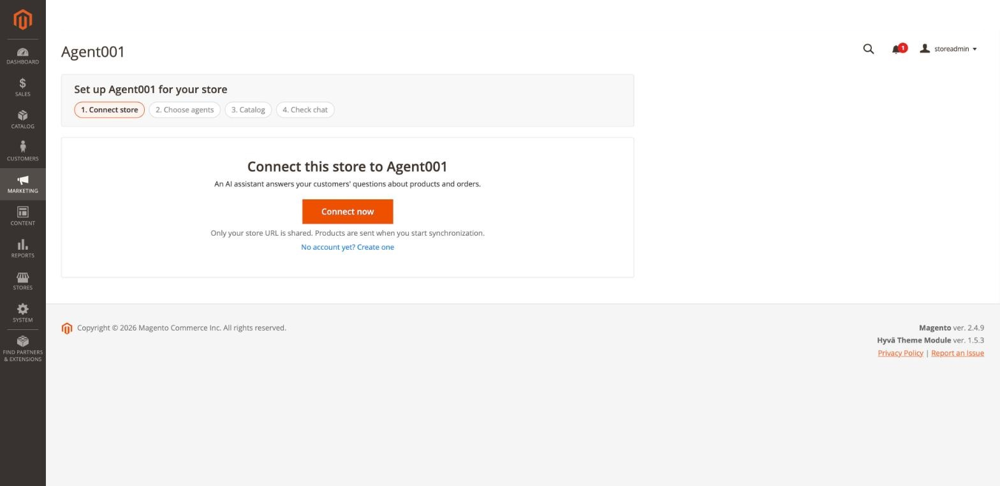
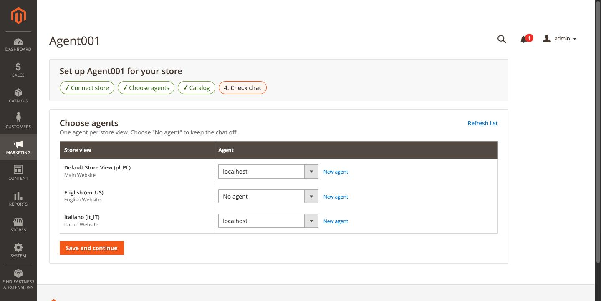

# Agent001 Assistant for Magento 2

AI shopping assistant for Magento Open Source and Adobe Commerce. It answers customers' questions about products and orders, using your synchronized catalog.



## Requirements

- Magento Open Source or Adobe Commerce 2.4.6 – 2.4.9, with or without Multi-Source Inventory
- PHP 8.1 or later with curl, intl and mbstring
- Magento cron, and preferably the `agent001:work` worker

## Installation

```sh
composer require agent001/module-assistant
bin/magento module:enable Agent001_Assistant
bin/magento setup:upgrade
bin/magento setup:di:compile
bin/magento setup:static-content:deploy
bin/magento cache:clean
```

Run the worker under Supervisor or systemd with automatic restart:

```sh
bin/magento agent001:work
```

Without the worker, the Magento cron processes the queue once a minute.

## Setup

Open **Marketing → Agent001 Assistant** and follow the wizard.

1. **Connect store.** Sign in to Agent001 and approve the connection.

   

2. **Choose agents.** One agent per store view.

   

3. **Catalog.** Choose the categories to send. A category includes its subcategories.
4. **Check chat.** Open the store and ask the assistant a question.

After setup, product changes, stock changes and orders are sent within about a minute, and the full catalog is synchronized every night.

If the store URL changes, the chat is hidden until you click **Update store URL** in the settings. To connect another Agent001 account, click **Disconnect** and then **Connect**.

## Console commands

| Command | Purpose |
| --- | --- |
| `agent001:work` | Process the synchronization queue |
| `agent001:work --once` | Process pending jobs and exit |
| `agent001:work --retry-failed --once` | Retry failed jobs |
| `agent001:sync [--store=<code\|id>]` | Queue a full catalog synchronization |

## Checkout and security

The chat is not loaded on Magento checkout payment pages. For a third-party checkout, remove it in your theme, for example in `Magento_Theme/layout/onestepcheckout_index_index.xml`:

```xml
<page><body><referenceBlock name="agent001.widget" remove="true"/></body></page>
```

Order lookups require the order number and the customer's e-mail address and are rate limited per visitor IP. Behind Varnish, a CDN or a load balancer, make sure Magento receives the real client IP.

## Limits

Up to 50,000 products per store view. Products that cannot be read are skipped and shown as "Skipped" in the settings.

## Support

https://agent001.ai/contact/ · biuro@okinet.pl

## License

Proprietary. © Okinet s.c. (Agent001).
